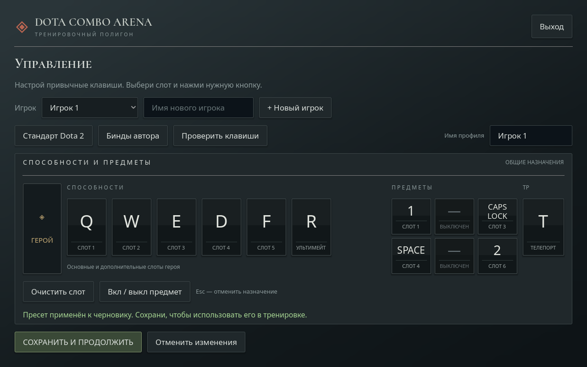

# Dota Combo Arena

Бесплатный автономный тренажёр клавиш для разминки перед Dota 2. Windows, Godot, открытый исходный код приложения.

**Версия 0.6.6:** пять героев с настоящими атаками и свободные шрифты Noto Sans и Cormorant SC.

[Скачать для Windows](https://github.com/chehlao1989-oss/DotaComboArena/releases/latest) · [Исходники](app/scripts)



## Скачать и запустить

Готовый ZIP находится в [Releases](https://github.com/chehlao1989-oss/DotaComboArena/releases). Распакуйте его полностью и запустите DotaComboArena.exe. Файл DotaComboArena.pck должен лежать рядом. Установка Dota 2 и подключение к Интернету для тренировки не требуются.

Windows x86_64, видеодрайвер с OpenGL 3.3. Проверялось на Windows с Intel Arc A750; проверка на других ПК ещё не проводилась. Сборка не подписана цифровой подписью.

## Возможности

- Windranger, Lina, Razor, Phantom Assassin и Dark Seer с настоящими игровыми атаками, отрендеренными в прозрачные кадры.
- Случайные последовательности способностей с добавлением предметов; скорость постепенно меняется по точности.
- Свои бинды, независимые профили игроков, проверка клавиш перед стартом.
- Разминки на 1, 3 и 5 минут, дополнительные способности только у подходящих героев.
- Личные рекорды и локальный ладдер профилей на одном ПК.
- Пауза, переключатели движения, эффектов и звука.

Тренажёр получает клавиши только в своём окне: не управляет Dota 2, не внедряется в игру и не читает её память. Цели выбираются автоматически. Это разминка последовательностей, не симуляция точных боевых таймингов. На быстром вводе визуальные атаки могут объединяться; каждое правильное нажатие учитывается немедленно.

## Исходный код и сборка

Откройте app/project.godot в Godot 4.7.2 stable и нажмите F6/F5. Код — app/scripts, данные героев — app/data, проверки — app/tests.

Для Windows-сборки установите Godot 4.7.2 и соответствующие Windows export templates, затем выполните PowerShell:

```powershell
./tools/build.ps1 -GodotPath 'C:/Tools/Godot/Godot_v4.7.2-stable_win64_console.exe' -ReleaseTemplate 'C:/Tools/Godot/windows_release_x86_64.exe'
```

Результат — builds/windows. Движок и шаблон в репозитории не хранятся. Убедитесь, что движок и шаблон одной версии. Скачать движок: https://godotengine.org/download/archive/.

Для проверки биндов и правил:

```powershell
godot --headless --path app --script res://tests/run_tests.gd
godot --headless --path app --script res://tests/run_arena_tests.gd
godot --headless --path app --script res://tests/run_record_tests.gd
```

Проверки интерфейса запускаются с графическим выводом: res://tests/run_layout_tests.gd.

## Данные и лицензии

Профили и рекорды сохраняются локально в `%APPDATA%/Godot/app_userdata/Dota Combo Arena/`. Пользовательские данные, ключи, рабочие логи, резервные копии и инструменты экспорта в репозиторий не включаются.

Оригинальный код приложения — [MIT](LICENSE). Игровые материалы Valve имеют отдельные условия, шрифты — SIL OFL 1.1, движок — MIT. См. [THIRD_PARTY_NOTICES.md](THIRD_PARTY_NOTICES.md). Проект неофициальный и не связан с Valve. Открытая лицензия кода не передаёт права на игровые материалы.
